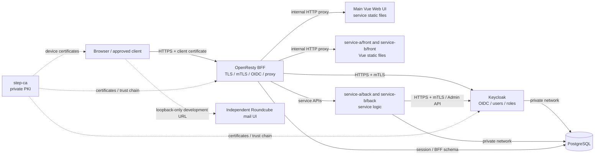

# System Architecture

## High-level view

## Trust boundaries

- OpenResty is the only externally exposed application entry point.
- Keycloak, all service back ends, and PostgreSQL remain on the Docker network.
- The step-ca administration and issuance endpoint is loopback-only in
  development and restricted to an administration network in production.
- Vue is served by OpenResty on the same origin. The browser never connects
  directly to a service back end or to an internal Keycloak hostname.
- Roundcube and the docker-mailserver stack are independent auxiliary
  services. Their development bindings are loopback-only and they are not
  OpenResty routes or vweb service APIs.

## Communication matrix

| From | To | Transport | Authentication and encryption |
|---|---|---|---|
| Browser | OpenResty | HTTPS | step-ca client certificate mTLS |
| OpenResty | Keycloak | HTTPS | OpenResty client certificate and Keycloak server certificate are mutually verified |
| OpenResty | service front containers | Docker network | Internal HTTP proxy; no host binding |
| OpenResty | `service-a/back`, `service-b/back` | Docker network | Internal network in the initial design; service mTLS is a hardening option |
| Service back ends | Keycloak Admin API | HTTPS | Service-specific client certificate and service-account token |
| Keycloak | PostgreSQL | PostgreSQL protocol | Internal network; enable database TLS where required |
| Service back ends | PostgreSQL | PostgreSQL protocol | Internal network; enable database TLS where required |

## Request boundaries

| Path | Owner | Behavior |
|---|---|---|
| `/service-a/`, `/service-b/` | OpenResty and service front containers | Proxy service-specific Vue static files |
| `/` | OpenResty | Redirect to `/service-a/` after BFF authentication |
| `/auth/*` | OpenResty and Keycloak | OIDC login, callback, logout, and required protocol endpoints |
| `/api/service-a/v1/*`, `/api/service-b/v1/*` | OpenResty and service back ends | Validate the BFF session and proxy the request |
| `/healthz` | OpenResty | Internal process health check; not a public application route |

Roundcube is accessed independently at `http://127.0.0.1:3005/` in the
development Compose environment. It is intentionally outside the OpenResty
and BFF boundary.

## Request identity

The BFF is the trust boundary for request identity. It removes incoming
identity headers, validates the BFF session, and generates a new identity
context for each service back end. Service back ends are not externally
reachable and must reject requests that do not arrive through the trusted BFF
network path.

