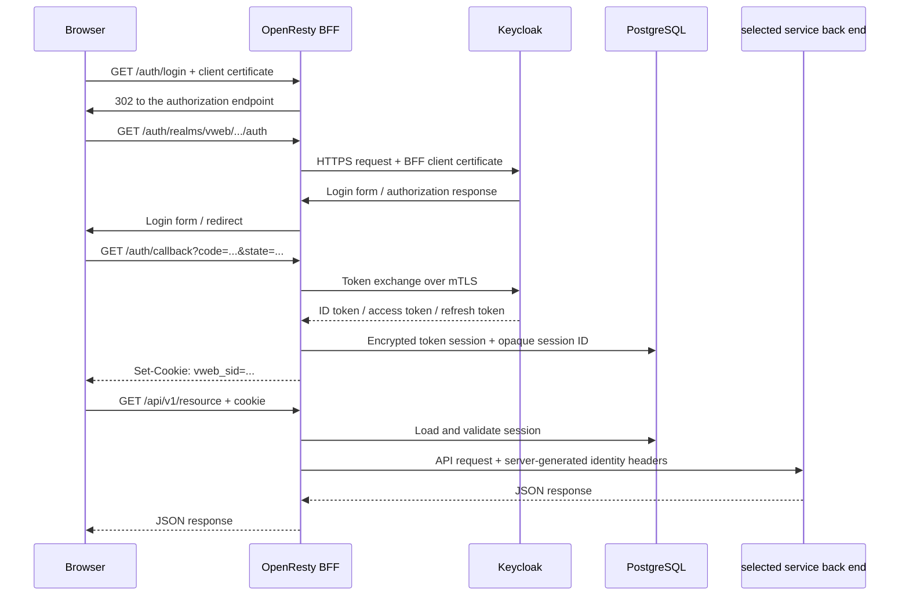

# Authentication and Authorization

## Authentication layers

Authentication has two independent layers:

1. **mTLS client authentication:** the client proves that its certificate was
   issued by the trusted step-ca and is allowed to connect to OpenResty.
2. **OIDC user authentication:** the user signs in through Keycloak, which
   issues the identity and role claims used by the BFF.

The first layer does not replace the second layer.

## Login flow

## Client to OpenResty mTLS

- OpenResty's server certificate and trusted client CA are issued by step-ca.
- Application, authentication, and API routes run with optional TLS client
  verification so the health listener can start without a certificate; each
  protected route rejects every value except `SUCCESS` from
  `$ssl_client_verify`.
- Missing, expired, revoked, or untrusted certificates are rejected during
  the TLS handshake.
- `/healthz` may be exempt from mTLS for container health checks, but it must
  remain unreachable from untrusted clients.

## OpenResty to Keycloak mTLS

- Keycloak listens on HTTPS using a step-ca server certificate.
- Keycloak requires the OpenResty client certificate and trusts the configured
  step-ca chain.
- OpenResty verifies the Keycloak server certificate and hostname.
- Keycloak accepts traffic only from the OpenResty network path.

## OIDC and session rules

- Use Authorization Code Flow with PKCE (S256).
- Allow `vweb` users to log in with either their username or their unique
  email address.
- Keep `duplicateEmailsAllowed` disabled in Keycloak and require a non-blank,
  case-insensitively unique email in each service-owned User projection.
- Require email verification for the realm. The local seed data keeps users
  `sample-user-01` through `sample-user-10` verified and users
  `sample-user-11` through `sample-user-20` unverified.
- Send local verification mail through the internal mailserver on the
  dedicated mail network; the mail flow does not use OpenResty.
- Validate `state`, `nonce`, the PKCE verifier, issuer, audience, and token
  timestamps.
- Include the `roles` client scope in the ID token as well as the access token;
  the BFF derives `platform-admin` and service/group client roles from the
  validated ID token before generating service identity headers.
- Store only an opaque session ID in the browser cookie.
- Store encrypted access and refresh tokens in PostgreSQL.
- Use `HttpOnly`, `Secure`, and `SameSite=Lax` cookie attributes.
- Delete the session on logout and on detected refresh-token failure.
- Never log tokens, cookie values, or client secrets.

## Identity headers to service back ends

OpenResty overwrites all incoming identity headers and generates these values:

| Header | Value |
|---|---|
| `X-Request-Id` | Request correlation ID |
| `X-User-Sub` | Keycloak subject |
| `X-User-Email` | Email address when needed by the use case |
| `X-User-Roles` | Normalized realm/client roles |
| `X-User-Groups` | Normalized hierarchical Keycloak group paths |
| `X-Client-Cert-Serial` | Client certificate serial number for auditing |

Service back ends must not treat client-provided versions of these headers as
trusted. They use `X-User-Sub` to load the canonical service authorization
records and use group paths only as authentication context. Service-to-service
mTLS may be added later as defense in depth.

## Proxy header policy

OpenResty must overwrite, not append, `Host`, `Forwarded`,
`X-Forwarded-For`, `X-Forwarded-Proto`, `X-Forwarded-Host`,
`X-Forwarded-Port`, and `X-Forwarded-Prefix` before forwarding to Keycloak.
The Keycloak proxy configuration must trust these headers only from the
OpenResty network path.

