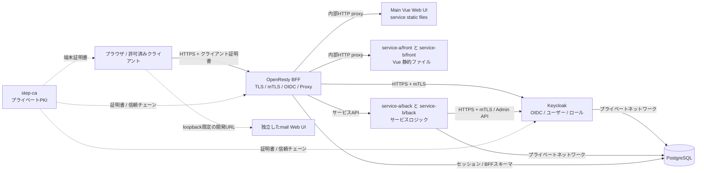

# システムアーキテクチャ

## 全体構成

## 信頼境界

- 外部公開するアプリケーション入口はOpenRestyだけとする。
- Keycloak、各サービスのback、PostgreSQLはDockerネットワーク内に閉じる。
- step-caの管理・発行エンドポイントは、開発環境ではloopbackだけに公開し、本番では管理ネットワークに限定する。
- VueはOpenRestyと同一オリジンで配信する。ブラウザから各サービスのbackやKeycloakの内部ホスト名へ直接接続しない。
- Roundcubeとdocker-mailserver stackは独立した補助serviceとする。開発用バインドはloopback限定であり、OpenRestyのrouteやvwebサービスAPIではない。

## 通信マトリクス

| 送信元 | 宛先 | 通信 | 認証・暗号化 |
|---|---|---|---|
| ブラウザ | OpenResty | HTTPS | step-caクライアント証明書によるmTLS |
| OpenResty | Keycloak | HTTPS | 双方の証明書を検証するmTLS |
| OpenResty | service frontコンテナ | Dockerネットワーク | 内部HTTP proxy。ホストへ公開しない |
| OpenResty | `service-a/back`、`service-b/back` | Dockerネットワーク | 初期設計は内部ネットワーク。サービス間mTLSは強化項目 |
| 各サービスのback | Keycloak Admin API | HTTPS | サービス専用クライアント証明書とservice-account token |
| Keycloak | PostgreSQL | PostgreSQLプロトコル | 内部ネットワーク。必要に応じてDB TLSを有効化 |
| 各サービスのback | PostgreSQL | PostgreSQLプロトコル | 内部ネットワーク。必要に応じてDB TLSを有効化 |

## リクエスト境界

| パス | 所有者 | 動作 |
|---|---|---|
| `/service-a/`、`/service-b/` | OpenRestyとservice frontコンテナ | サービスごとのVue静的ファイルをproxy |
| `/` | OpenResty | BFF認証後に`/service-a/`へredirect |
| `/auth/*` | OpenResty / Keycloak | OIDCログイン、callback、logout、必要なプロトコルエンドポイント |
| `/api/service-a/v1/*`、`/api/service-b/v1/*` | OpenResty / 各サービスのback | BFFセッションを検証して対応するbackへプロキシ |
| `/healthz` | OpenResty | 内部プロセスヘルスチェック。公開アプリケーションルートではない |

開発用Compose環境ではRoundcubeを`http://127.0.0.1:3005/`から独立して利用する。OpenRestyおよびBFFの境界外に置く。

## リクエストの認証コンテキスト

BFFをリクエスト認証の信頼境界とする。BFFは外部から送られた認証ヘッダーを削除し、BFFセッションを検証して、各サービスのback向け認証コンテキストを生成する。各サービスのbackは外部到達不能とし、信頼されたBFF経路以外からのリクエストを拒否する。

