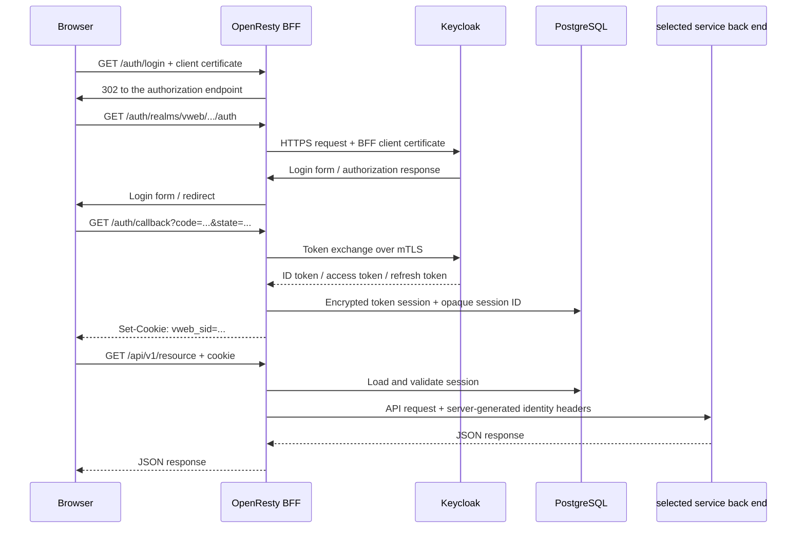

# 認証・認可

## 認証レイヤー

認証を2つの独立したレイヤーに分ける。

1. **mTLSクライアント認証：** 信頼されたstep-caが発行した証明書で、OpenRestyへ接続可能なクライアントであることを確認する。
2. **OIDC利用者認証：** Keycloakで利用者がログインし、BFFが利用するIDとロールのclaimを取得する。

第1レイヤーは第2レイヤーの代替ではない。

## ログインフロー

## ブラウザからOpenRestyへのmTLS

- OpenRestyのサーバー証明書と信頼するクライアントCAはstep-caから発行する。
- アプリケーション、認証、API routeはTLS client verificationをoptionalで起動し、health listenerが証明書なしでも起動できるようにする。保護された各routeは`$ssl_client_verify`が`SUCCESS`以外の場合に拒否する。
- 証明書なし、期限切れ、失効済み、信頼チェーン不正の接続はTLSハンドシェイクで拒否する。
- `/healthz`はコンテナヘルスチェック用にmTLS対象外としてよいが、信頼されないクライアントから到達不能にする。

## OpenRestyからKeycloakへのmTLS

- Keycloakはstep-ca発行のサーバー証明書でHTTPS待ち受けする。
- KeycloakはOpenRestyのクライアント証明書を必須とし、step-caチェーンを信頼する。
- OpenRestyはKeycloakのサーバー証明書とホスト名を検証する。
- Keycloakへの到達元はOpenRestyのネットワーク経路だけに限定する。

## OIDCとセッションルール

- Authorization Code Flow with PKCE（S256）を利用する。
- `vweb`ユーザーはユーザー名または一意なメールアドレスでログインできるようにする。
- Keycloakの`duplicateEmailsAllowed`を無効化し、各サービス所有User投影でも空でないemailと大文字小文字を区別しない一意性を必須とする。
- Realmではメールアドレス確認を必須にする。ローカルseedでは`sample-user-01`から`sample-user-10`を確認済み、`sample-user-11`から`sample-user-20`を未確認として作成する。
- ローカルの確認メールは専用mail network上のmailserverへ送信し、OpenRestyは経由しない。
- `state`、`nonce`、PKCE verifier、issuer、audience、token timestampを検証する。
- `roles` client scopeをaccess tokenだけでなくID tokenにも含める。BFFは検証済みID tokenから`platform-admin`とservice／GroupのClient Roleを取り出し、サービス認証ヘッダーを生成する。
- ブラウザCookieには不透明なセッションIDだけを保存する。
- 暗号化したアクセストークンとリフレッシュトークンをPostgreSQLへ保存する。
- Cookieには`HttpOnly`、`Secure`、`SameSite=Lax`を設定する。
- logout時、およびリフレッシュトークンの失敗検知時にセッションを削除する。
- token、Cookie値、Client secretをログへ出力しない。

## 各サービスのbackへ渡す認証ヘッダー

OpenRestyは外部から来た認証ヘッダーを上書きし、次の値を生成する。

| ヘッダー | 内容 |
|---|---|
| `X-Request-Id` | リクエスト相関ID |
| `X-User-Sub` | Keycloak subject |
| `X-User-Email` | ユースケースで必要な場合のメールアドレス |
| `X-User-Roles` | Realm／Clientロールの正規化済み一覧 |
| `X-User-Groups` | Keycloakの階層Group pathの正規化済み一覧 |
| `X-Client-Cert-Serial` | 監査用の端末証明書シリアル番号 |

各サービスのbackはクライアントが送信した同名ヘッダーを信頼してはならない。`X-User-Sub`で正規のサービス認可レコードを取得し、Group pathは認証コンテキストとして利用する。防御の多層化として、後続でサービス間mTLSを追加できる。

## プロキシヘッダー方針

OpenRestyはKeycloakへ転送する前に、`Host`、`Forwarded`、`X-Forwarded-For`、`X-Forwarded-Proto`、`X-Forwarded-Host`、`X-Forwarded-Port`、`X-Forwarded-Prefix`を追記ではなく上書きする。KeycloakはOpenRestyのネットワーク経路からのヘッダーだけを信頼する。

